# Watchy Caffeine
## Stay active for weeks!

Watchy Caffeine is low-power firmware for the ESP32-based Watchy 2.0. You can set the time from your phone and choose from 18 faces designed for the watch. With 140 mAh of usable battery capacity, the estimated runtime is **17 to 21 days**, depending on your step and Night mode settings.

## Set the time

On the watch, open **Menu → Clock → Sync with phone**. Scan the QR code to join the `Caffeine-XXXX` Wi-Fi network. The Wi-Fi sign-in page copies the time and current UTC offset from your device. This works offline. Sync again after travelling or when the clocks change.

If the QR code doesn’t join the network, use the name and password printed below it. If the sign-in page doesn’t appear, open `http://192.168.4.1` in a browser while connected to the watch.


## Controls and settings

The bottom-left button opens **Menu** from the face. 

| Button | Action in menus |
| --- | --- |
| Top left | Back |
| Bottom left | Select |
| Top right | Up |
| Bottom right | Down |

The **Clock** menu also lets you set the date and time by hand, switch between 12- and 24-hour time, and change the UTC offset in 15-minute steps.

## Watch faces

Open **Menu → Watch face** and use the right buttons to browse. Press **Select** to save the highlighted face. All 18 faces support 12- and 24-hour time.

| Ledger | Split | Dial |
| :---: | :---: | :---: |
| 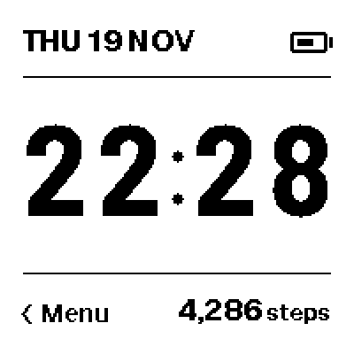 | 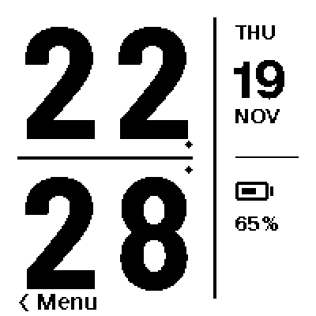 | 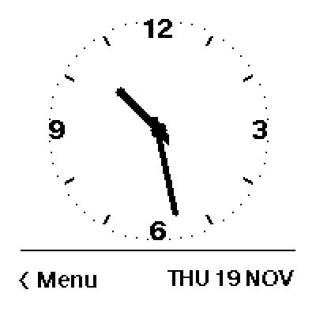 |
| **Signal Box** | **Patchbay** | **Pocket Console** |
| 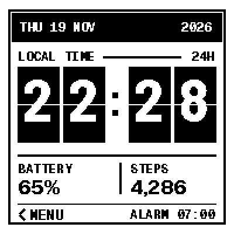 | 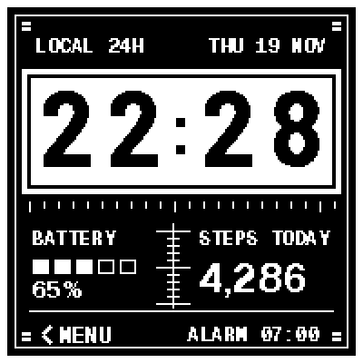 | 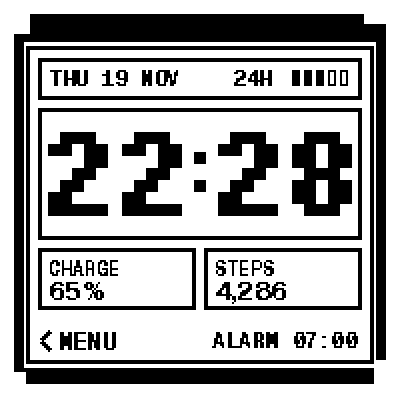 |
| **Filing Card** | **Chart Table** | **Woodcut Tide** |
| 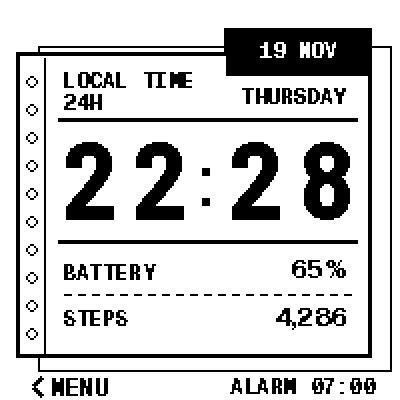 | 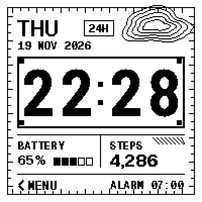 | 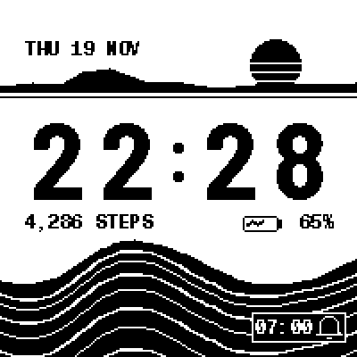 |
| **Concrete Study** | **Blockprint Iris** | **Ink Observatory** |
| 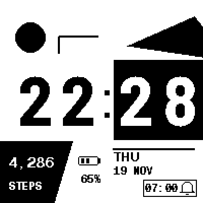 | 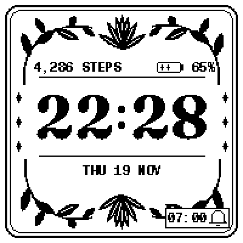 | 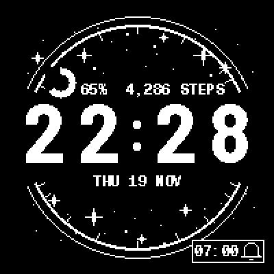 |
| **Film Leader** | **Minute Atlas** | **Quarter Dial** |
| 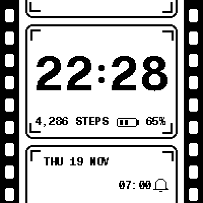 | 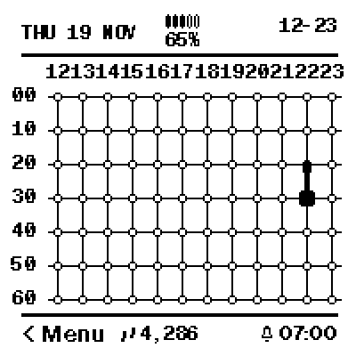 | 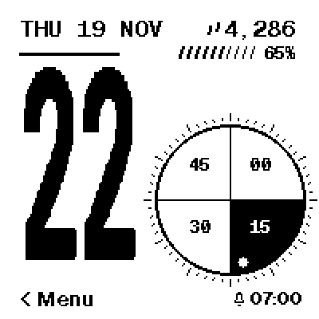 |
| **Letterpress Time** | **Shortwave** | **Domino** |
| 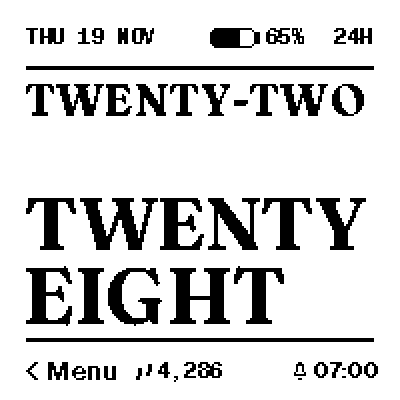 | 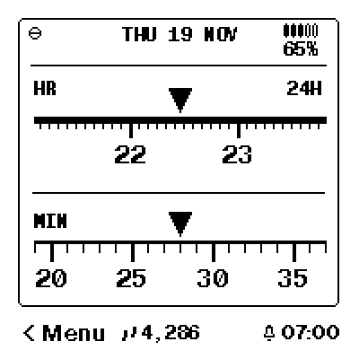 | 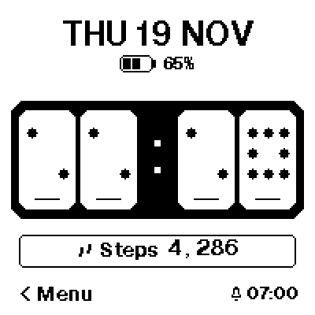 |


## Steps and Night mode

In **Menu → Steps**, you can see today's count and choose **Off**, **Daytime**, or **Always**. Daytime starts out set to 07:00–23:00. You can change both times. The daily count resets at local midnight.

**Night mode** has a separate schedule, initially 23:00–07:00. Turn it on in **Menu → Night mode**. While the watch sits still, the display holds the last time it showed. Lift the watch to update the time, or use the buttons as usual.

## Alarm, countdown, and stopwatch

Set the daily alarm in **Menu → Alarm**, in five-minute steps. **Menu → Timers** has a countdown you can pause and resume and a stopwatch with room for five laps. Timers keep running when you go back to the watch face. A daily alarm or countdown can wake the watch during Night mode. Press any button to dismiss the alert.

## Battery life

These estimates use the Ledger face, 140 mAh of usable capacity, about 20 short menu visits a day, and 10–40 motion-triggered refreshes per night when Night mode is on.

| Step counting | Minute updates all day | With Night mode |
| --- | ---: | ---: |
| Off | 19.0 days | 20.9–21.1 days |
| Daytime | 17.4 days | 18.9–19.1 days |
| Always | 16.7 days | 18.9–19.1 days |

I measured display timings on the watch and used modeled currents for the board, display, and accelerometer. Dividing usable battery capacity by the estimated daily consumption gives the runtimes above. With Night mode off, switching faces changes the estimate by up to 0.4 days. With the default 16-hour schedule, Daytime counting gives about 0.7 days more than Always.

### Power use

The external clock wakes the ESP32 for per-minute updates. Between those wakes the ESP32 stays in deep sleep. Night mode skips the regular overnight wakeups and keeps the deadlines the watch still needs, such as the next alarm.

The ESP32 goes into light sleep during the e-paper waveform and again while the panel's booster shuts down after a partial refresh. The panel's BUSY pin wakes it. In the Shortwave timing test, an ordinary minute update took about 0.54 seconds at the panel, with about 0.49 seconds spent in those sleep calls.

For partial updates, the firmware sends the old and new pixels for the changed rectangle. It skips identical frames and does an occasional full refresh to clear ghosting.

The BMA423 counts steps and detects motion while the ESP32 sleeps. After a motion wake, the firmware waits three seconds before arming the next one. Wi-Fi runs only during phone setup. The watch samples battery voltage periodically and writes settings to flash when a value changes.

## Hardware and tests

Tested on one Watchy 2.0-compatible board with an ESP32-PICO-D4 rev. 1.1, 4 MiB of DIO flash, a WCH CH9102 USB serial bridge, a BMA423 accelerometer, a PCF8563-compatible RTC, and a 200 × 200 monochrome e-paper display. Check the pinout and factory partition layout before flashing a different revision.

## Install

The app goes at `0x10000` on the tested stock layout and uses the existing bootloader and partition table. Download [watchy_caffeine.bin](watchy_caffeine.bin) and use esptool 4.13. Substitute your serial port for `/dev/ttyACM0`. Make the full-flash backup before writing the app and keep the backup private.

```sh
PORT=/dev/ttyACM0
printf '%s  %s\n' \
  c76239a3045c2ee5966804deafcfa10561b644d11300d59c993ae1afd8bff51f \
  watchy_caffeine.bin | sha256sum -c -

esptool --chip esp32 --port "$PORT" --baud 460800 \
  read_flash 0x0 0x400000 watchy-backup.bin
esptool --chip esp32 --port "$PORT" --baud 460800 --after no_reset \
  write_flash --flash_mode keep --flash_freq keep --flash_size keep \
  0x10000 watchy_caffeine.bin
esptool --chip esp32 --port "$PORT" --baud 460800 \
  verify_flash 0x10000 watchy_caffeine.bin
```

## Build from source

Use ESP-IDF **v5.5.6** at commit `880a203ae603d08a94d06aa01e0d6761958e5e9e` with the `esp32` target. Board code is in [source/candidate](source/candidate). The watch logic and renderer are in [source/watch](source/watch). [ESP-IDF v5.5.6](https://github.com/espressif/esp-idf/tree/v5.5.6).

```sh
idf.py -C source/candidate -B "$PWD/build" \
  -D "SDKCONFIG=$PWD/build/sdkconfig" \
  -D 'SDKCONFIG_DEFAULTS=sdkconfig.defaults;sdkconfig.demo' \
  -D WATCHY_INITIAL_UTC_OFFSET=60 build
```

The output is `build/watchy_caffeine.bin`. The stock layout is defined in [partitions-stock.csv](source/partitions-stock.csv). `WATCHY_INITIAL_UTC_OFFSET` sets the first-use offset in minutes. This build reproduced the release binary byte for byte.

The bitmap assets are checked in and build as supplied. To regenerate them, use the [source fonts](assets/fonts) and [asset scripts](tools). The four release bitmap includes were reproduced with Python, Pillow 12.3.0, and FreeType 2.14.3.

```sh
python3 -B -s tools/make_watchy_ui_font.py assets/fonts
python3 -B -s tools/make_face_art.py
python3 -B -s tools/make_watchy_experimental_assets.py
python3 -B -s tools/pack-maximalist.py
```

## License

Project code is licensed under the GNU General Public License, version 3. Bundled components and fonts keep their upstream licenses. The GPLv3 additional permission covers the specific precompiled Espressif archives linked into the app. [GPLv3](LICENSE), [additional permission](ADDITIONAL-PERMISSION.md), [third-party notices](THIRD_PARTY_NOTICES.md).
